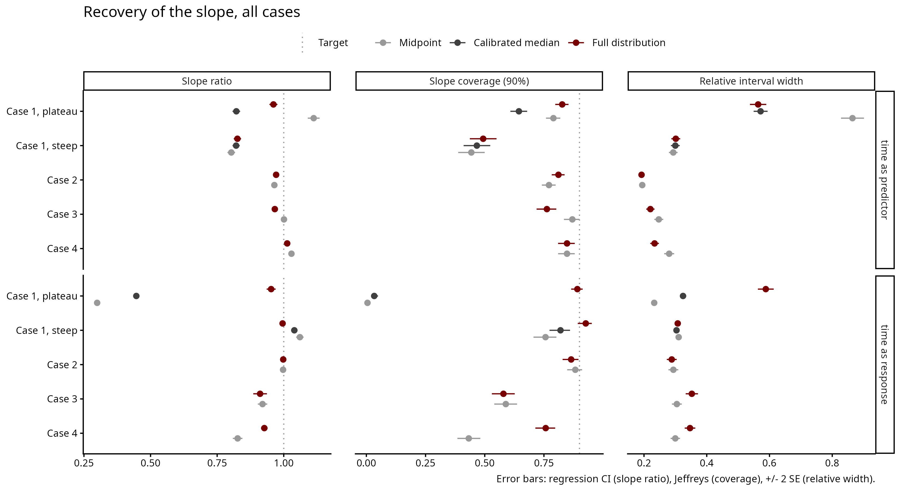
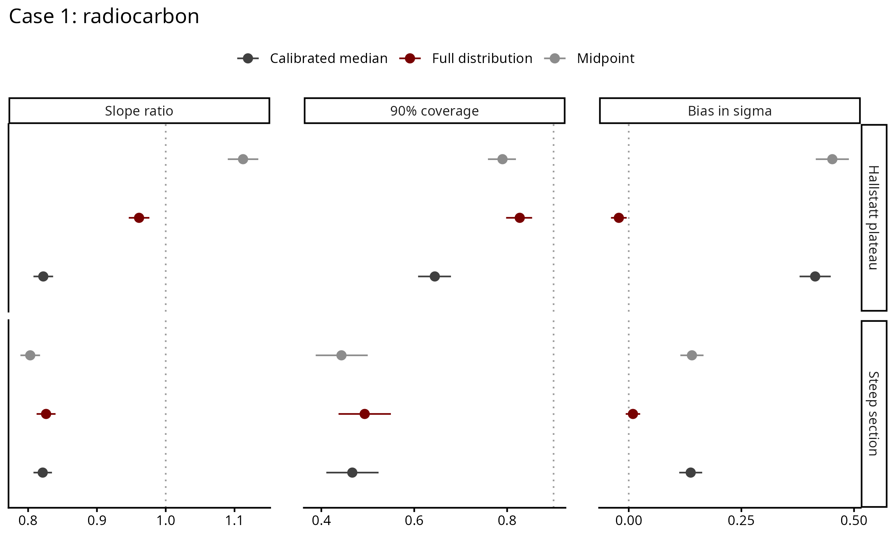
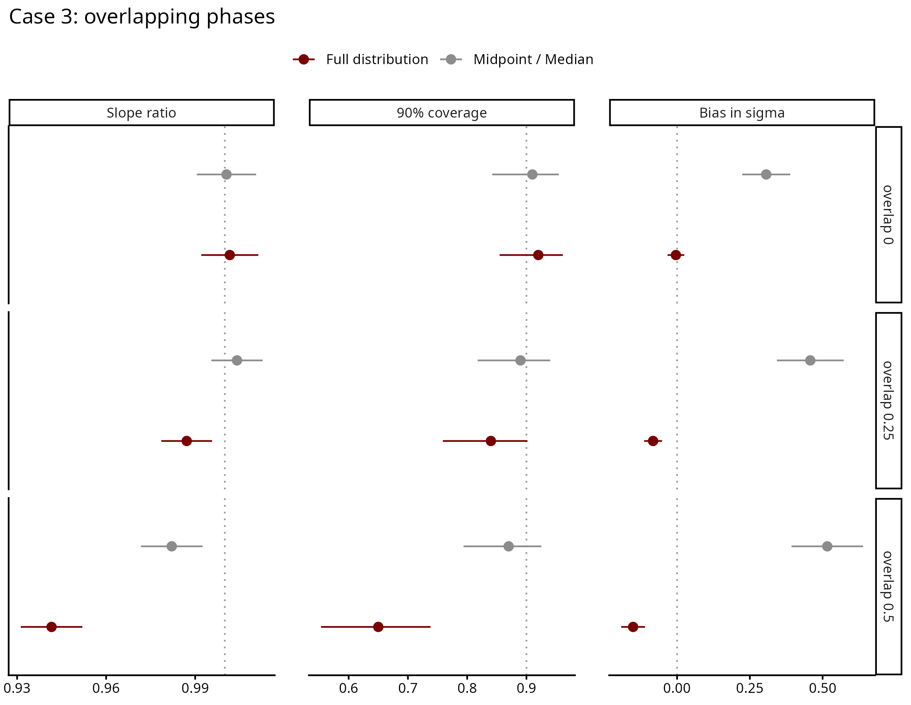
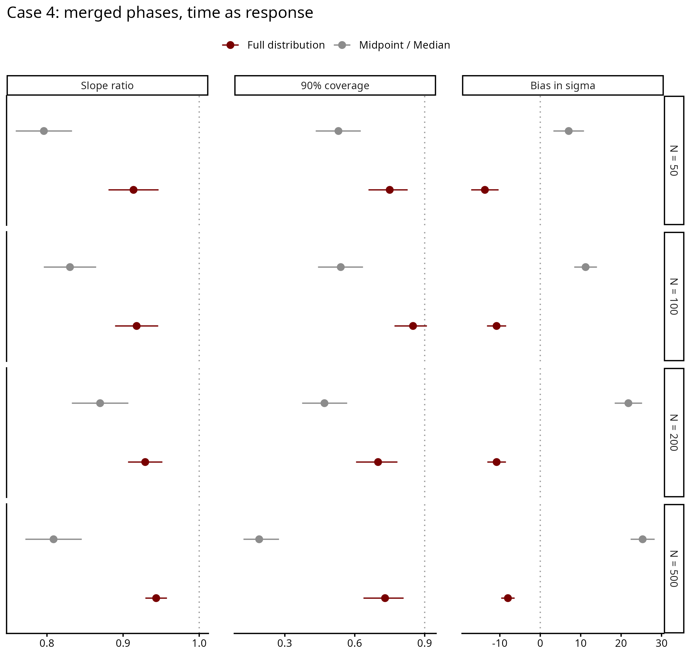
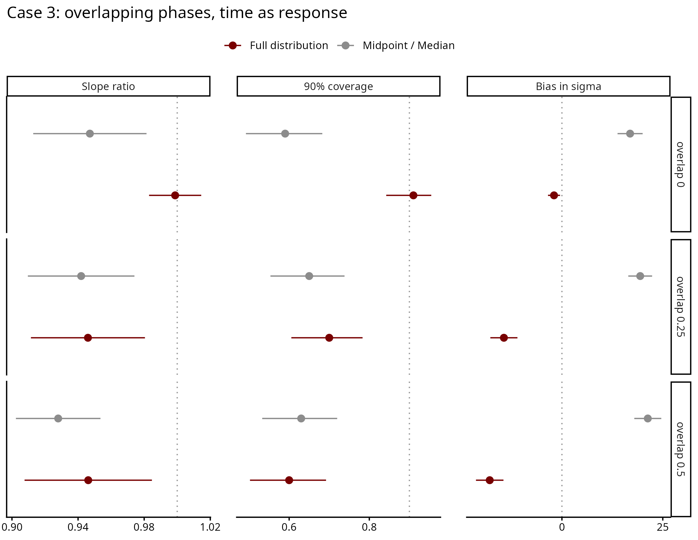
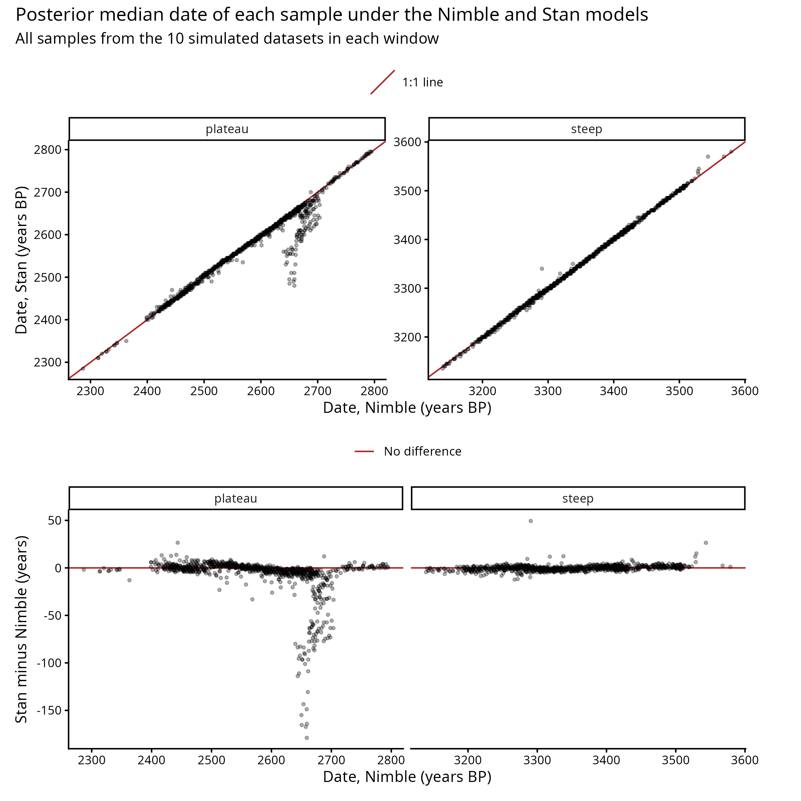

# Results

State of the recovery studies, 14 October 2026. Each case folder's README has
the details; known limitations are in `Notes/limitations.md`.

Contents:
- [Measures and overview](#measures-and-overview)
- [Time as predictor](#time-as-predictor)
- [Time as response](#time-as-response)
- [Comparison with the Nimble model](#comparison-with-cremas-nimble-model)
- [Open questions](#open-questions)

## Measures and overview

Measures, computed on datasets with a real (non-zero) slope:
- **Slope ratio**: posterior median slopes regressed on the true slopes across
  datasets (1 = recovered, below 1 = flattened, above 1 = steepened).
- **Coverage**: share of datasets whose 90% interval contains the true slope
  (target 0.90).
- **σ bias**: estimated minus true σ (the scatter around the trend). Positive:
  the scatter is overestimated; negative: underestimated. Target 0.

Points: the measure across all datasets in a group. Lines: its 95% interval given
the number of datasets (regression confidence interval for the slope ratio,
Jeffreys interval for coverage). The slope ratio is the slope of a regression of
the estimated slopes on the true slopes across datasets. Dividing each estimate
by its true slope and averaging would not work: many datasets have a true slope
close to zero, and a small error divided by a near-zero slope gives an enormous
ratio that would swamp the average.

## Time as predictor

Value = intercept + slope × date. σ in units of the measured value (true σ 0.5-4).

| Case | Point dates: slope ratio / coverage / σ bias | Full distribution |
|---|---|---|
| 1, steep section | midpoint 0.80 / 0.44 / +0.14; median 0.82 / 0.47 / +0.14 | 0.83 / 0.49 / +0.01 |
| 1, Hallstatt plateau | midpoint 1.11 / 0.79 / +0.45; median 0.82 / 0.64 / +0.41 | 0.96 / 0.83 / −0.02 |
| 2, typochronology | 0.965 / 0.77 / +0.13 | 0.97 / 0.81 / −0.01 |
| 3, overlapping phases | 1.00 / 0.87 / +0.41 | 0.97 / 0.76 / −0.16 |
| 4, merged phases | 1.03 / 0.85 / +0.60 | 1.01 / 0.85 / −0.07 |

- Point dates overestimate σ in every case; the full distribution recovers it
  except in Case 3.
- Midpoints recover the slope for phase-dated finds (Cases 2-4). With
  radiocarbon the calibrated median flattens the slope, and on the steep section
  every method does.
- Case 3: with overlapping phases the published window is wider than where the
  finds fall, so the flat window misleads the full distribution. Given the true
  shape of each window it reaches slope ratio 1.00 and coverage 0.90. The
  midpoint's advantage survives one-sided overlaps.

## Time as response

Date = intercept + slope × value. σ in years.

| Case | Point dates: slope ratio / coverage / σ bias | Full distribution |
|---|---|---|
| 1, Hallstatt plateau | midpoint 0.30 / 0.005 / +1.7; median 0.45 / 0.03 / +22 | 0.95 / 0.89 / −1.9 |
| 1, steep section | midpoint 1.06 / 0.76 / +25.5; median 1.04 / 0.82 / +23.9 | 1.00 / 0.93 / +0.1 |
| 2, typochronology | 1.00 / 0.88 / +9 | 1.00 / 0.87 / −0.4 |
| 3, overlapping phases | 0.92 / 0.59 / +16 | 0.91 / 0.58 / −21 |
| 4, merged phases | 0.83 / 0.43 / +16 | 0.93 / 0.76 / −11 |

- On the radiocarbon plateau point dates recover a third to a half of the slope;
  the full distribution recovers it.
- With merged phases the midpoint flattens the slope, and its coverage falls as
  datasets grow (0.53 at N = 50, 0.19 at N = 500).
- Case 3: the same window-shape problem as with time as predictor. Without
  overlap the full distribution recovers everything (1.00, coverage 0.91).
- Dates of single finds (Cases 3-4): the trend narrows each phase window to
  60-70% of its width, and the date intervals contain the true date for 84-88%
  of finds.
- Case 1: 166 of 1400 plateau datasets do not converge with the full
  distribution (mostly zero or weak trends); they are excluded above.

## Comparison with the Nimble model

Case 1, time as response: posterior dates of single samples agree in 19 of 20
datasets. In the exception Nimble settled on an almost flat trend with σ of
20 yr against a true 70 yr.

## Open questions

- Prior on σ for time as response: with long windows and few finds the fit can
  collapse onto a nearly flat line with σ close to 0 (50 of 1100 Case 3
  datasets). Keep the exponential prior and report it, or use one that is zero
  at σ = 0 (gamma, shape 2) and refit (about a week)?
- Case 3 core setting: assign_p 0.2 (80% of overlap finds go to the later
  phase) or 0.5 (coin flip)?
