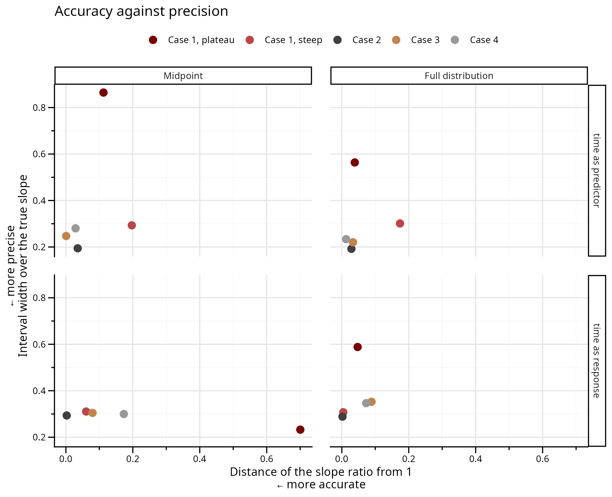
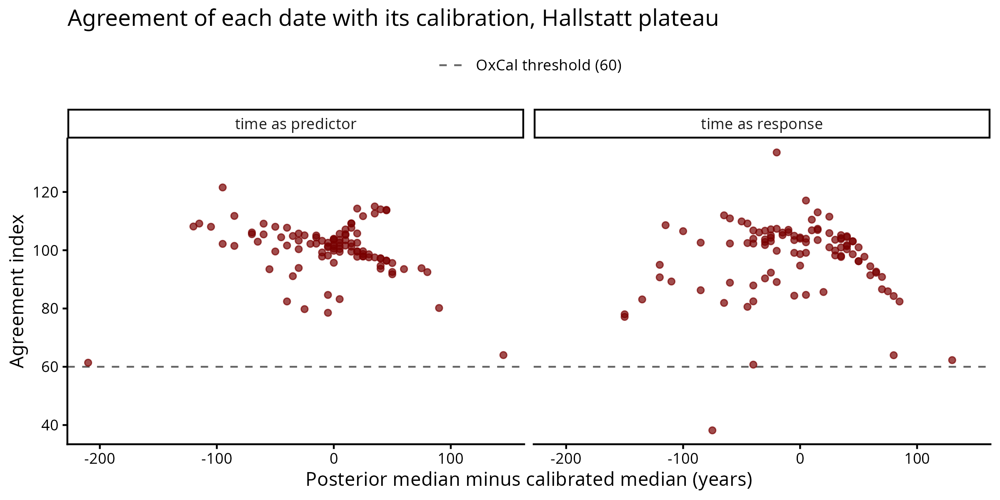
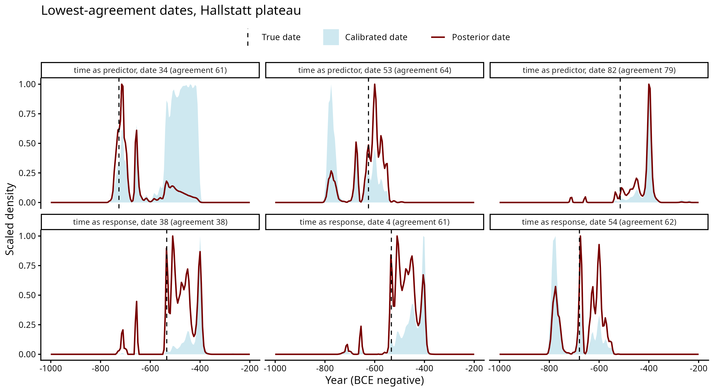

# Results

> [!NOTE]
> Simulation recovery studies. Last update: 
14 October 2026. 

Further details for each case are provided in the subfolders' READMEs.

## Contents
- [Measures and overview](#measures-and-overview)
- [Time as predictor](#time-as-predictor)
- [Time as response](#time-as-response)
- [Dates of single finds](#dates-of-single-finds)
- [Comparison with the Nimble model](#comparison-with-the-nimble-model)

## Measures and overview

Measures, computed on datasets with a real (non-zero) slope:
- **Slope ratio**: posterior median slopes regressed on the true slopes across
  datasets (1 = recovered, below 1 = flattened, above 1 = steepened).
- **Coverage**: share of datasets whose 90% interval contains the true slope
  (target 0.90).
- **σ bias**: estimated minus true σ (the scatter around the trend). Positive:
  the scatter is overestimated; negative: underestimated. Target 0.
- **Relative interval width** (precision): mean width of the slope's 90% interval, divided
  by the size of the true slope (to make it comparable across different cases). Smaller = more precise.

Points: the measure across all datasets in a group. Error bars: its 95% interval,
of the kind each measure calls for — a regression CI for the slope ratio (it is a
regression coefficient), a Jeffreys interval for coverage (a proportion, and the
usual normal approximation breaks down near 0 and 1), +/- 2 standard errors for
the relative width (a mean).

The slope ratio is the slope of a regression of the estimated slopes on the true
slopes across datasets. Dividing each estimate by its true slope and averaging
would not work: many datasets have a true slope close to zero, and a small
error divided by a near-zero slope gives an enormous ratio that would swamp the
average.

The three panels answer different questions, and a method can do well on one and
badly on another. Time as response on the plateau is the clearest example: the
midpoint gives the narrowest interval of the three (relative width 0.23 against
0.59 for the full distribution) and its interval almost never contains the true
slope (coverage 0.005). A narrow interval is only worth having where coverage is
close to 0.90.

The same two measures, accuracy and precision, plotted against each other, one
panel per direction and method:

The bottom left corner is accurate and tight. With time as predictor the full
distribution moves the plateau left and down, more accurate and tighter at once.
With time as response it moves it left and up: the accuracy is bought with
width. Outside radiocarbon the two methods sit close together in both
directions.

Only the midpoint and the full distribution are shown. In Cases 2-4 the windows
are flat, so the median is the midpoint; in Case 1 the calibrated median is a
third method, in the figure above.

## Time as predictor

Value = intercept + slope × date. σ in units of the measured value (true σ 0.5-4).

| Case | Point dates: slope ratio / coverage / σ bias | Full distribution |
|---|---|---|
| 1, steep section | midpoint 0.80 / 0.44 / +0.14; median 0.82 / 0.47 / +0.14 | 0.83 / 0.49 / +0.01 |
| 1, Hallstatt plateau | midpoint 1.11 / 0.79 / +0.45; median 0.82 / 0.64 / +0.41 | 0.96 / 0.83 / −0.02 |
| 2, typochronology | 0.965 / 0.77 / +0.13 | 0.97 / 0.81 / −0.01 |
| 3, overlapping phases | 1.00 / 0.87 / +0.41 | 0.97 / 0.76 / −0.16 |
| 4, merged phases | 1.03 / 0.85 / +0.60 | 1.01 / 0.85 / −0.07 |

- Point dates overestimate σ in every case; the full distribution recovers it
  except in Case 3.
- Midpoints recover the slope for phase-dated finds (Cases 2-4). With
  radiocarbon the calibrated median flattens the slope, and on the steep section
  every method does.
- Case 3: with overlapping phases the published window is wider than where the
  finds fall, so the flat window misleads the full distribution. Given the true
  shape of each window it reaches slope ratio 1.00 and coverage 0.90. The
  midpoint's advantage survives one-sided overlaps.

## Time as response

Date = intercept + slope × value. σ in years.

| Case | Point dates: slope ratio / coverage / σ bias | Full distribution |
|---|---|---|
| 1, Hallstatt plateau | midpoint 0.30 / 0.005 / +1.7; median 0.45 / 0.03 / +22 | 0.95 / 0.89 / −1.9 |
| 1, steep section | midpoint 1.06 / 0.76 / +25.5; median 1.04 / 0.82 / +23.9 | 1.00 / 0.93 / +0.1 |
| 2, typochronology | 1.00 / 0.88 / +9 | 1.00 / 0.87 / −0.4 |
| 3, overlapping phases | 0.92 / 0.59 / +16 | 0.91 / 0.58 / −21 |
| 4, merged phases | 0.83 / 0.43 / +16 | 0.93 / 0.76 / −11 |

- On the radiocarbon plateau point dates recover a third to a half of the slope;
  the full distribution recovers it.
- With merged phases the midpoint flattens the slope, and its coverage falls as
  datasets grow (0.53 at N = 50, 0.19 at N = 500).
- Case 3: the same window-shape problem as with time as predictor. Without
  overlap the full distribution recovers everything (1.00, coverage 0.91).
- Dates of single finds (Cases 3-4): the trend narrows each phase window to
  60-70% of its width, and the date intervals contain the true date for 84-88%
  of finds.
- Case 1: 166 of 1400 plateau datasets do not converge with the full
  distribution (mostly zero or weak trends); they are excluded above.

## Dates of single finds

Fitting the trend also sharpens the date of each find, in both directions.

- Phase windows, time as response (Cases 3-4): each find's 90% date interval
  shrinks to 60-70% of its window, and contains the true date for 84-88% of finds.
- Radiocarbon dates on the Hallstatt plateau (one dataset of 100 dates per
  direction): the trend moves the median of each date by 25-35 years on average
  (up to 200), while the dates stay consistent with their calibration. With
  time as response, 1 date of 100 falls below the agreement threshold of 60
  used in OxCal; with time as predictor, none. The same dataset fitted with the
  Nimble model gives the same three lowest dates and an overall agreement of 70
  (Stan 72).

## Comparison with the Nimble model

Case 1, time as response: posterior dates of single samples agree in 19 of 20
datasets. In the exception Nimble settled on an almost flat trend with σ of
20 yr against a true 70 yr.
The Nimble model uses the code from [this Github repository](https://github.com/ercrema/statistical_modelling_review/blob/main/measurement_error_example.R).

The 20 plateau datasets that did not converge in Stan were refitted with Nimble:
18 of them do not converge there either, often worse (R-hat up to 8, chains that
disagree on the sign of the slope, σ far below the truth). These datasets are
hard because the data say little about the trend, not because of the model
software.

## Open questions

- Prior on σ for time as response: with long windows and few finds the fit can
  collapse onto a nearly flat line with σ close to 0 (50 of 1100 Case 3
  datasets). Keep the exponential prior and report it, or use one that is zero
  at σ = 0 (gamma, shape 2) and refit (about a week)?
- Case 3 core setting: assign_p 0.2 (80% of overlap finds go to the later
  phase) or 0.5 (coin flip)?
