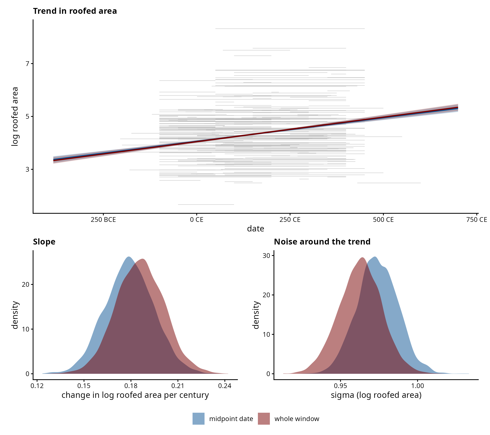
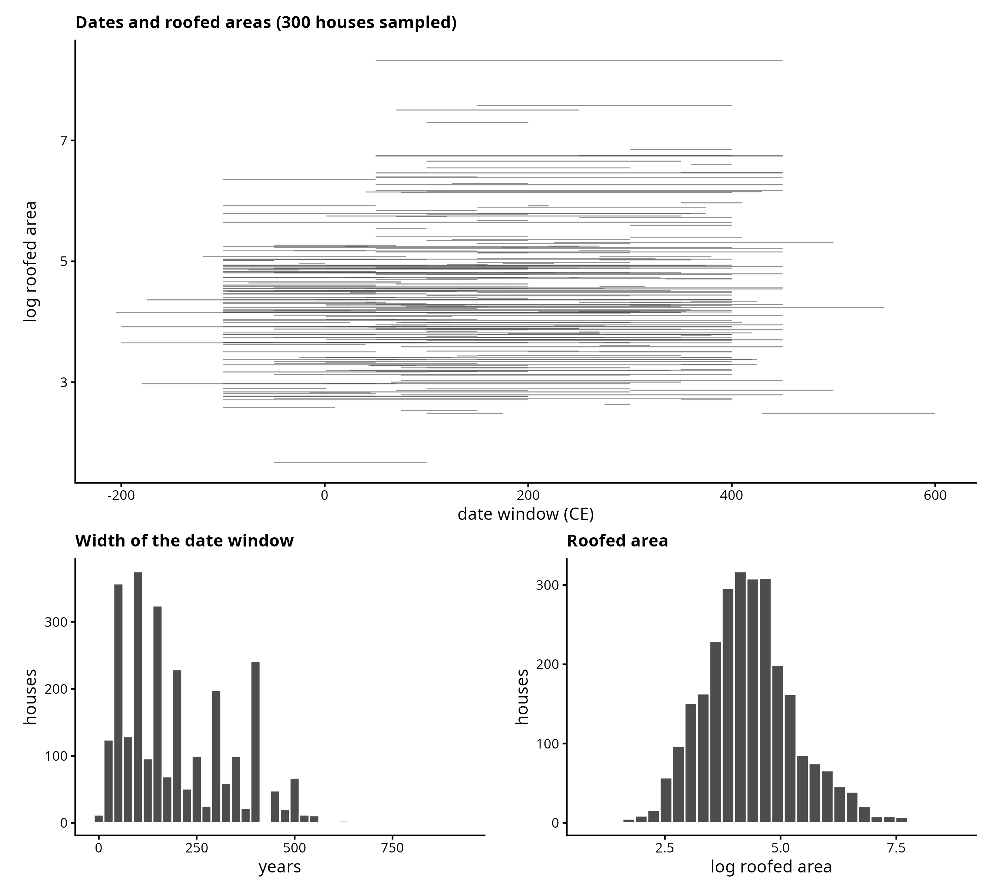

# dataset_1 — House size and date (GINI database)

Roofed area rises across the first millennium, and almost every house in the
database is dated to a window rather than to a year. Fitting the trend means
deciding what to do with those windows: collapse each to its midpoint, as is
usual, or carry the whole window into the model. This is the time-as-predictor
direction — the measured value is the response, the date the predictor.

## Source

The GINI database of house sizes (`gini_database_all_records_20240721.csv`).

Subset: Great Britain, nuclear-family houses, positive roofed area, a dated
window (`EndHouse > BeginHouse`) and a midpoint in [-100, 1000] — **2,682 houses
from 746 sites**. The response is `log(RoofedArea)`; the date of each house is
the window `[BeginHouse, EndHouse]`.

Windows are wide: 3 to 915 years, median 150, against a span of 384 BCE to 700
CE. Dating is coarse enough here that the choice of treatment is not academic.

## Scripts

| Script | Purpose | Output |
|---|---|---|
| `01_prepare.R` | filter the database, write the subset, exploratory panel | `gini_gb_filtered.csv`, `dataset_1_exploratory_panel.png` |
| `02_fit.R` | fit both dating treatments, save fits and diagnostics | `fits.rds`, `fit_summary.csv`, `diagnostics.txt` |
| `03_compare.R` | comparison figure | `dataset_1_model_comparison.png` |

Both treatments use `Simulations/shared/models/linear_dates.stan`, the model the
simulations use, with a 5-year grid of candidate years. The midpoint treatment
is the same model given one candidate year per house. Fitting is separated from
plotting so figures can be restyled without refitting; the fits take about four
minutes each and are run in a tmux `BTChron` session.

## Result

| | slope (log roofed area per century) | sigma |
|---|---|---|
| midpoint date | 0.179 [0.154, 0.205] | 0.974 [0.952, 0.996] |
| whole window | 0.186 [0.161, 0.210] | 0.963 [0.940, 0.985] |

Both treatments converged cleanly: 0 divergences, max Rhat 1.00, min bulk ESS
3,474.

The two agree on the trend well within their intervals: carrying the window
moves the slope by 4%, against a credible interval five times that wide. Sigma
is lower under the whole-window treatment, which is the direction the
simulations predict — date uncertainty that is not modelled is absorbed into the
residual variance instead. With no ground truth on real data the figures carry
no truth overlay; the contrast between the two treatments is the point.

The size of that contrast is itself informative. For flat windows of this kind
the simulations find the midpoint recovers the slope and misstates only sigma,
so a small slope difference and a lower sigma is the expected result, not a weak
one.

## Exploratory panel

