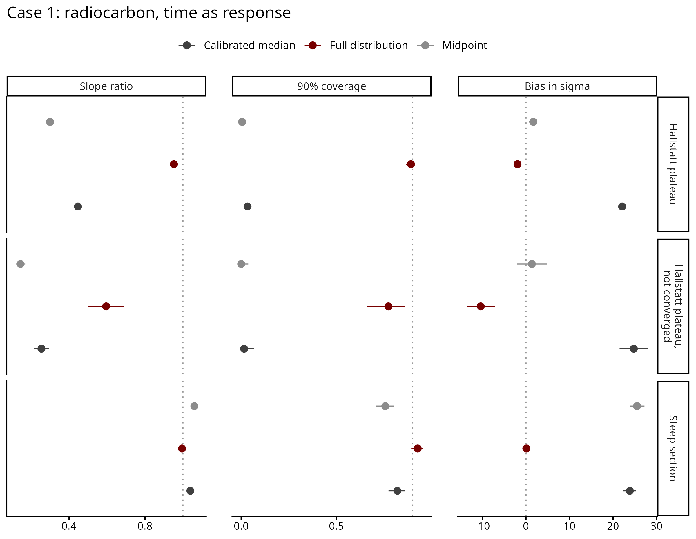
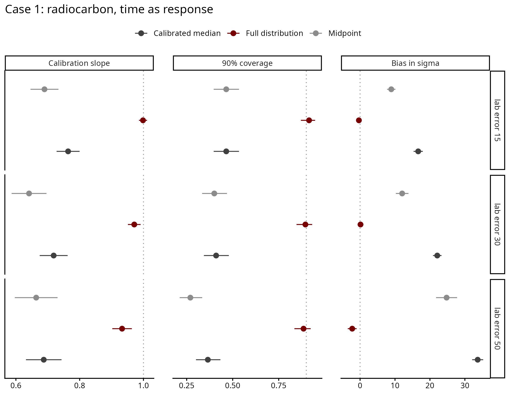

# Case 1 — Radiocarbon, time as response

The same dating situation as Case 1 time as predictor (calibrated 14C dates),
with time as the response: the date changes with a measured value known exactly,
date = intercept + slope × value. The setup follows the reference
measurement_error_example.R.

## Contents
- [How the data is generated](#how-the-data-is-generated)
- [Results](#results)
- [Comparison with the Nimble model](#comparison-with-the-nimble-model)
- [Files](#files)

## How the data is generated

For each dataset (`scripts/02_recovery_study.R`, dating step in
`shared/dating/case1_radiocarbon.R`):

1. Values drawn evenly between 0 and 1000.
2. True dates = intercept + slope × value + noise. Across the values the trend
   moves the date by 25-75% of a 400-year window; the noise sd is 5-20% of the
   window. Dates are centred on the window.
3. Each true date becomes a 14C age with a lab error and is calibrated with
   IntCal20.

Two windows: the Hallstatt plateau (800-400 BCE) and a steep section of the
curve (1600-1200 BCE). The design (`scripts/01_design.R`), 100 datasets per
setting:

| Sweep | Varies |
|---|---|
| core | dataset size 50, 100, 200, 500; slope random or zero; plateau, lab error 30 |
| factor | lab error 15, 30, 50 crossed with window; N = 200 |

## Results

Run of 2026-10-07/10: 1400 datasets, 4200 fits (midpoint, calibrated median and
full distribution), none failed. 166 full-distribution fits did not converge
(R-hat above 1.05), all on the plateau: 100 with a zero slope and 66 with a weak
trend (the trend moves the date by 16% of the window on average, against 35% for
the converged datasets). Their results are shown separately.

Real slope, converged:

| | Slope ratio | Coverage | σ bias (yr) |
|---|---|---|---|
| Plateau, midpoint | 0.30 | 0.005 | +1.7 |
| Plateau, calibrated median | 0.45 | 0.03 | +22 |
| Plateau, full distribution | 0.95 | 0.89 | −1.9 |
| Steep section, midpoint | 1.06 | 0.76 | +25.5 |
| Steep section, calibrated median | 1.04 | 0.82 | +23.9 |
| Steep section, full distribution | 1.00 | 0.93 | +0.1 |

(Plateau: 634 datasets; steep section: 300.)

On the plateau, point dates recover a third to a half of the slope and their
intervals almost never contain it. On the steep section all methods recover the
slope, but point dates overestimate σ by about 25 yr. The full distribution
recovers the slope and σ in both windows.

A larger lab error makes point dates worse (both windows together, slope ratio
0.69, 0.64, 0.66 for the midpoint at lab error 15, 30, 50) and leaves the full
distribution close to 1 (1.00, 0.97, 0.93).

The 90% interval contains the true σ in 88% of datasets with the full
distribution, 19% with the midpoint and 7% with the median. With no real trend,
it excludes zero in 3% (full distribution), 11% (median) and 13.5% (midpoint) of
datasets.

The 66 non-converged plateau datasets with a real slope give a slope ratio of
0.60 and coverage of 0.77 with the full distribution.

Every chain starts near a flat trend with σ about 100 yr. With Stan's default
random starts, 326 fits did not converge; most had one chain trapped in a minor
peak of the posterior. That run is in `output/archive/run_2026-10-06_random_inits/`.

## Comparison with the Nimble model

`scripts/checks/00_compare_nimble.R` fits 10 plateau and 10 steep-section
datasets with the Nimble model and with the Stan model (run before the
starting values were added). The slopes agree, and the posterior dates of single
samples agree in 19 of the 20 datasets. In the one exception (plateau, dataset
10) Nimble settled on an almost flat trend with σ of 20 yr against a true 70 yr;
Stan's slope was closer to the truth. Figures in `figures/checks/`.

## Files

Run in order: `01` → `02` → `03`.

| File | What it does |
|---|---|
| `scripts/01_design.R` | builds `data/design.csv` |
| `scripts/02_recovery_study.R` | fits the three methods to every dataset; about three days on 47 workers |
| `scripts/03_recovery_plots.R` | `output/recovery_metrics.csv` and the figures |
| `scripts/checks/00_compare_nimble.R` | the comparison with the Nimble model |
