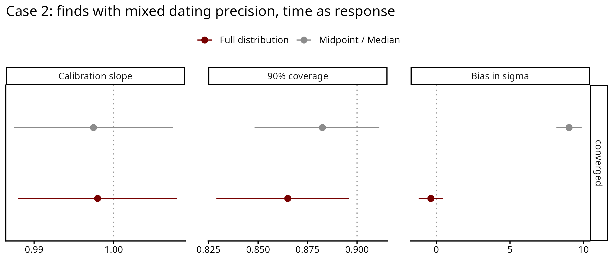
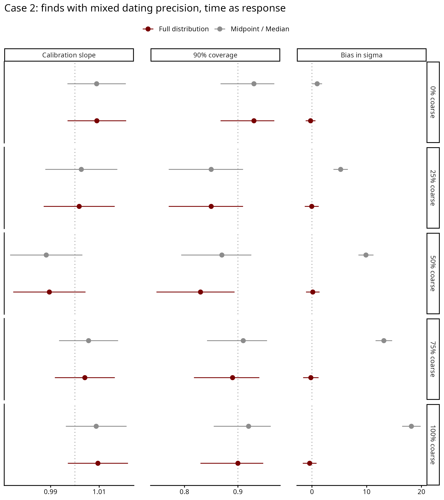
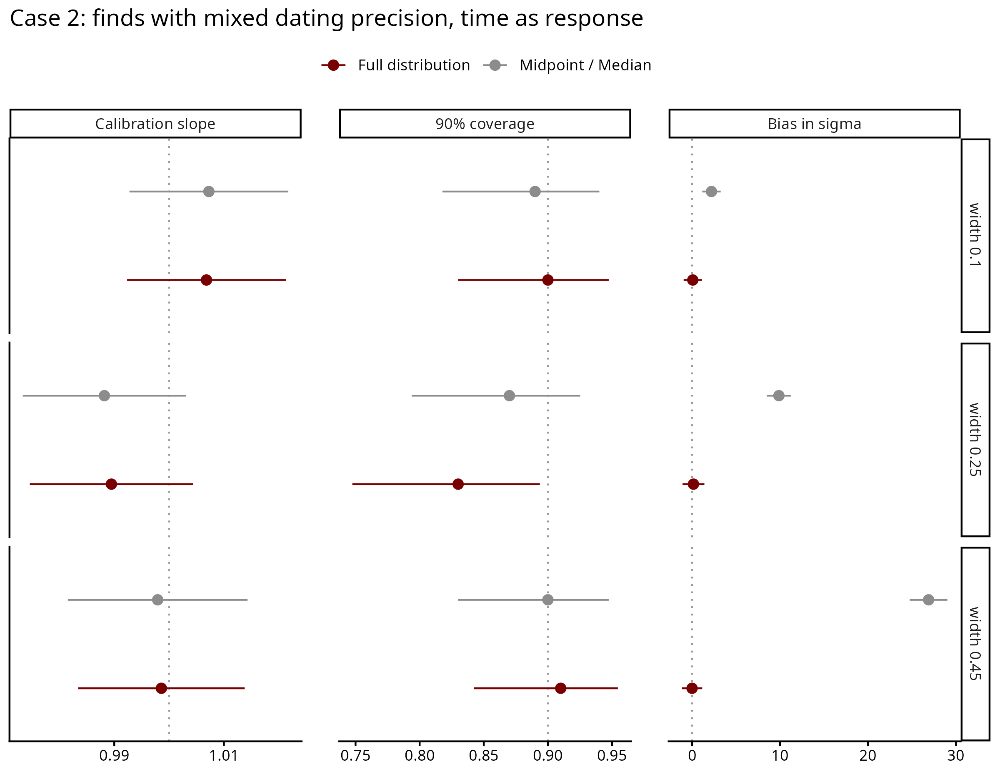

# Case 2 — Typochronology, time as response

The same dating situation as Case 2 time as predictor (each find has its own
window, some narrow and some coarse), with time as the response: the date
changes with a measured value known exactly, date = intercept + slope × value.

## How the data is generated

For each dataset (`scripts/02_recovery_study.R`, dating step in
`shared/dating/case2_typochronology.R`):

1. Values drawn evenly between 0 and 1000.
2. True dates = intercept + slope × value + noise. Across the values the trend
   moves the date by 25-75% of the study period (100-900); the noise sd is 5-20%
   of the period.
3. Each find is coarsely dated with a given probability. A coarse window is
   about `coarse_frac` of the period long, a fine window 50 yr; the window is
   placed at random around the true date.

The design (`scripts/01_design.R`), 100 datasets per setting, the rest at the
reference (N = 200, half the finds coarse, coarse windows 25% of the period, no
precision trend):

| Sweep | Varies |
|---|---|
| core | dataset size 50, 100, 200, 500; slope random or zero |
| prop | proportion of coarse finds 0, 0.25, 0.75, 1 |
| width | coarse window 10% or 45% of the period |
| precision | coarse finds more common early than late |

## Results

Run of 2026-10-07/08: 1500 datasets, 3000 fits (midpoint and full distribution),
none failed. All full-distribution fits converged.

Core sweep, real slope, 400 datasets:

| | Slope ratio | Coverage | σ bias (yr) |
|---|---|---|---|
| Midpoint | 1.00 | 0.88 | +9 |
| Full distribution | 1.00 | 0.87 | −0.4 |

Both methods recover the slope: dating error in the response does not bias it
here. The midpoint overestimates σ, more so as dating gets coarser: +1 yr with no
coarse finds, +18 yr with all finds coarse, +27 yr with coarse windows of 45% of
the period. The full distribution stays within half a year of the true σ in
every setting.

The 90% interval contains the true σ in 91% of datasets with the full
distribution and 48% with the midpoint. With no real trend, it excludes zero in
9% (full distribution) and 9.5% (midpoint) of datasets.

Every chain starts near a flat trend with σ about 100 yr. With Stan's default
random starts, 26 fits did not converge (some chains started far from the data
and never came back); that run is in
`output/archive/run_2026-10-06_random_inits/`.

## Files

Run in order: `01` → `02` → `03`.

| File | What it does |
|---|---|
| `scripts/01_design.R` | builds `data/design.csv` and checks the generator |
| `scripts/02_recovery_study.R` | fits both methods to every dataset; about ten hours on 48 workers when the server is otherwise free |
| `scripts/03_recovery_plots.R` | `output/recovery_metrics.csv` and the figures |
