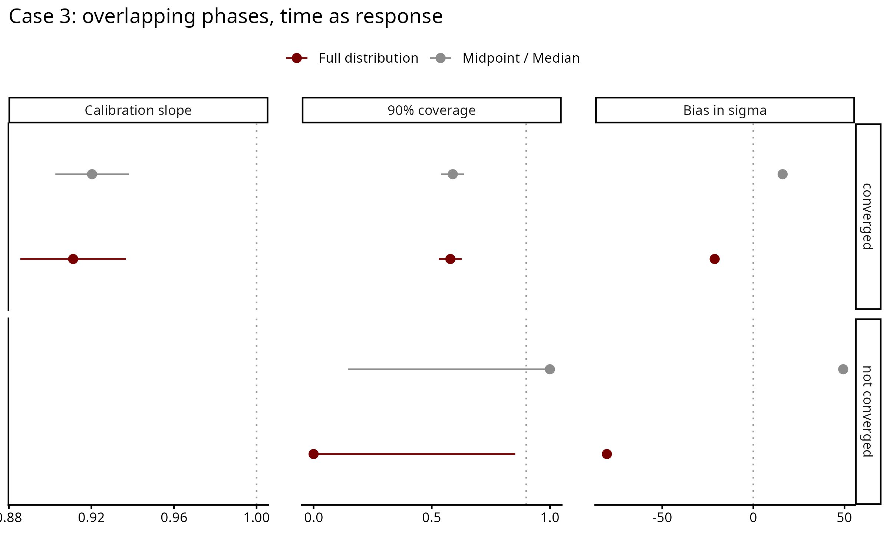

# Case 3 — Overlapping phases, time as response

The same dating situation as Case 3 time as predictor (ceramic phases whose
windows overlap at their edges), with time as the response: the date changes
with a measured value known exactly, date = intercept + slope × value.

## How the data is generated

For each dataset (`scripts/02_recovery_study.R`, dating step in
`shared/dating/case3_overlapping_phases.R`):

1. Values drawn evenly between 0 and 1000.
2. True dates = intercept + slope × value + noise. Across the values the trend
   moves the date by 25-75% of the study period (100-900); the noise sd is 5-20%
   of the period.
3. The range of the true dates is split into K phases (5 to 10). Each phase
   window is stretched by `overlap` times its length, half on each side. A find
   in a strip shared by two windows is given the earlier phase with probability
   `assign_p`. Every window contains its true date.

The design (`scripts/01_design.R`), 100 datasets per setting:

| Sweep | Varies |
|---|---|
| core | dataset size 50, 100, 200, 500; slope random or zero; overlap 0.5, assign_p 0.2 |
| factor | overlap 0, 0.25, 0.5 crossed with assign_p 0.5, 0.35, 0.2; at N = 200 |

## Results

Run of 2026-10-10/13: 1500 datasets, 3000 fits (midpoint and full distribution),
none failed. Three full-distribution fits did not converge (R-hat above 1.05).

Core sweep, real slope, 399 converged datasets:

| | Slope ratio | Coverage | σ bias (yr) |
|---|---|---|---|
| Midpoint | 0.92 | 0.59 | +16 |
| Full distribution | 0.91 | 0.58 | −21 |

At the core setting both methods flatten the slope a little and cover it in
under 60% of datasets. The midpoint overestimates σ and the full distribution
underestimates it.

Overlap drives the result (assign_p 0.5, N = 200):

| Overlap | Midpoint: slope ratio / coverage | Full distribution: slope ratio / coverage / σ bias |
|---|---|---|
| 0 | 0.95 / 0.59 | 1.00 / 0.91 / −2 yr |
| 0.25 | 0.94 / 0.65 | 0.95 / 0.70 / −14 yr |
| 0.5 | 0.93 / 0.63 | 0.95 / 0.60 / −18 yr |

Without overlap the full distribution recovers the trend. With overlap the flat
window misstates where the dates fall, since the true dates thin out towards the
edges of a stretched window, as in the time-as-predictor direction (see
`Notes/limitations.md`). In 50 of 1100 datasets with a real slope the full
distribution puts σ below half its true value: when the windows are long, a
nearly flat line with little scatter can pass through all of them.

The 90% interval contains the true σ in 51% of datasets with the full
distribution and 26% with the midpoint. With no real trend, it excludes zero in
10% (full distribution) and 8.5% (midpoint) of datasets.

Dates of single finds (full distribution): the 90% date interval of a find is on
average 0.63 of its window and contains the true date for 84% of finds (0.77 and
92% without overlap).

## Files

Run in order: `01` → `02` → `03`.

| File | What it does |
|---|---|
| `scripts/01_design.R` | builds `data/design.csv` and checks the generator |
| `scripts/02_recovery_study.R` | fits both methods to every dataset; about three days on 20 workers |
| `scripts/03_recovery_plots.R` | `output/recovery_metrics.csv`, `output/date_recovery.csv` and the figures |
