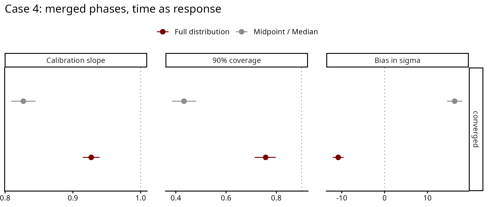
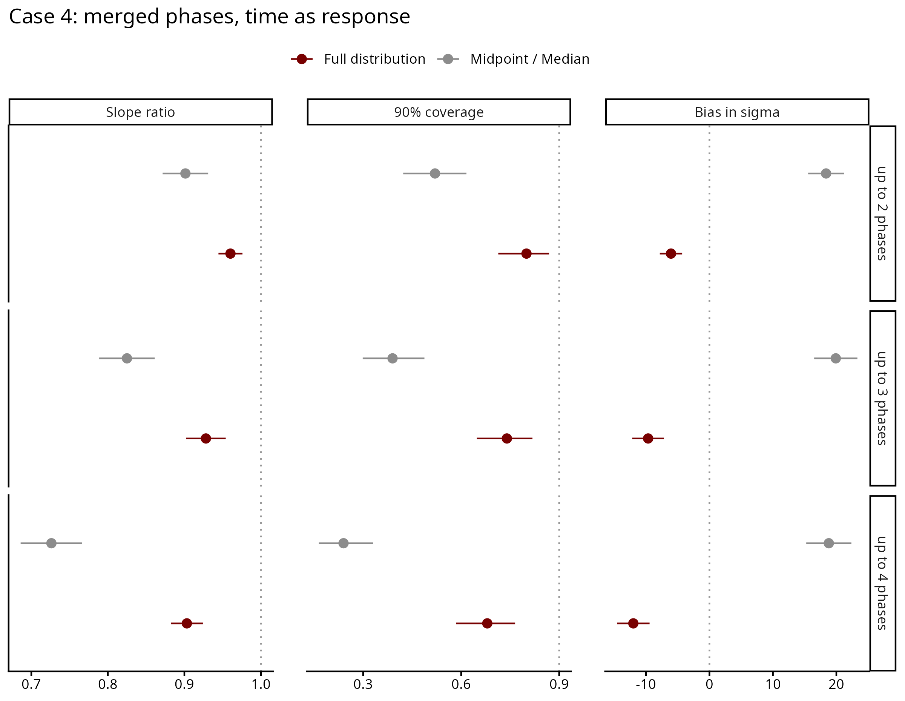

# Case 4 — Merged phases, time as response

The same dating situation as Case 4 time as predictor (finds dated to one fine
phase or to a run of adjacent phases), with time as the response: the date
changes with a measured value known exactly, date = intercept + slope × value.

## Contents
- [How the data is generated](#how-the-data-is-generated)
- [Results](#results)
- [Files](#files)

## How the data is generated

For each dataset (`scripts/02_recovery_study.R`, dating step in
`shared/dating/case4_merged_phases.R`):

1. Values drawn evenly between 0 and 1000.
2. True dates = intercept + slope × value + noise. Across the values the trend
   moves the date by 25-75% of the study period (100-900); the noise sd is 5-20%
   of the period.
3. The range of the true dates is split into K fine phases (5 to 10), and each
   find is dated to a run of 1 to `merge_max` adjacent phases that includes its
   own. Every window contains its true date.

The design (`scripts/01_design.R`), 100 datasets per setting:

| Sweep | Varies |
|---|---|
| core | dataset size 50, 100, 200, 500; slope random or zero; merge_max 3 |
| merge | merge_max 2, 3, 4; at N = 200 |

## Results

Run of 2026-10-10/12: 1100 datasets, 2200 fits (midpoint and full distribution),
none failed. Two full-distribution fits did not converge (R-hat above 1.05).

Core sweep, real slope, 400 datasets:

| | Slope ratio | Coverage | σ bias (yr) |
|---|---|---|---|
| Midpoint | 0.83 | 0.43 | +16 |
| Full distribution | 0.93 | 0.76 | −11 |

The midpoint flattens the slope, and its coverage falls as datasets grow (0.53
at N = 50, 0.19 at N = 500). Both methods do worse as broad periods widen: at
merge_max 2 and 4 the slope ratio is 0.90 and 0.73 for the midpoint, 0.96 and
0.90 for the full distribution.

The 90% interval contains the true σ in 71% of datasets with the full
distribution and in 28% with the midpoint.

With no real trend, the 90% interval excludes zero in 11% (midpoint) and 10%
(full distribution) of datasets.

Dates of single finds (full distribution): the 90% date interval of a find is on
average 0.69 of its window (0.61 at merge_max 4), and contains the true date for
88% of finds.

The full distribution does better than the midpoint but stays below the nominal
0.90 coverage and underestimates σ slightly. The cause is not yet known; see
`Notes/limitations.md`.

## Files

Run in order: `01` → `02` → `03`.

| File | What it does |
|---|---|
| `scripts/01_design.R` | builds `data/design.csv` and checks the generator |
| `scripts/02_recovery_study.R` | fits both methods to every dataset; about two days on 20 workers |
| `scripts/03_recovery_plots.R` | `output/recovery_metrics.csv`, `output/date_recovery.csv` and the figures |
